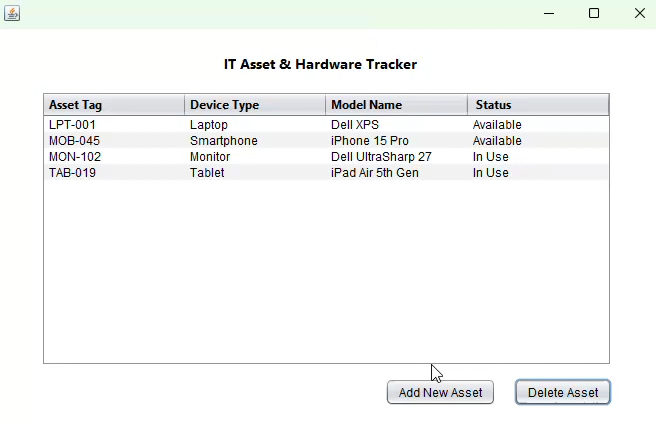

# IT Asset & Hardware Tracker

A desktop Java application designed to manage internal company hardware, track asset allocations, and monitor inventory status. Built with a strict Model-View-Controller (MVC) architecture and Data Access Object (DAO) patterns.

## Features
- **Full CRUD Functionality:** Add new hardware, view current allocations, and permanently delete retired or lost assets directly from the UI.
- **Inline Status Updates:** Modify asset availability directly within the data grid using dynamic dropdowns that sync instantly to the MySQL backend.
- **Enterprise UI:** Clean, high-contrast Java Swing interface optimized for data entry and inventory management.
- **Database Integration:** Persistent data storage utilizing a local MySQL server and structured JDBC connections.

## Tech Stack
- **Language:** Java
- **GUI Framework:** Java Swing
- **Database:** MySQL 8.0 (Connector/J)
- **Architecture:** MVC & Data Access Object (DAO)

## Installation & Setup
1. Clone the repository to your local machine.
2. Import the project into your preferred Java IDE (e.g., Apache NetBeans).
3. Execute the `database_setup.sql` script in MySQL Workbench to build the `it_asset_db` schema and `assets` table.
4. Navigate to `src/com/itmanager/util/DatabaseConnection.java` and update the database credentials to match your local MySQL environment.
5. Build and run the project.